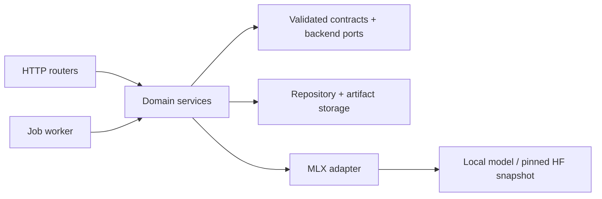

# Architecture

The [customer workflow layer](WORKFLOW.md) composes these modules. `workflows/` owns
definitions, cycles and releases; `feedback/` owns human decisions; `training/imports.py`
handles operator-staged local models. Cycle creation and job enqueueing share a SQLite
transaction enforcing the latest parent, cycle budget and no active workflow job.
Release submission is also serialized and limited to one audit per cycle.


## Direction of dependencies



`container.py` is the composition root. Router functions parse requests and call services. They do not know how to train a model. Provider imports are lazy: importing the app does not import MLX, initialize SQLite, resolve models or start jobs.

Each concern has a concrete implementation; the backend ports separate training, inference and optimization. The initial `MLXBackend` implements all three. Tests inject an entirely separate provider through `Container(settings, backend=...)`.

## Persistence

`RIG_HOME` owns `rig.sqlite3`, lock files and `artifacts/`. No pipeline writes to sibling labs or to the website.

SQLite uses WAL and short transactions. Connections are opened per operation, not shared across API threads. The repository persists immutable dataset/candidate/report/deployment records, mutable job state, an input-to-split registry and active deployment aliases. SQL values are parameterized.

Artifacts use generated IDs and confined relative paths:

```text
.rig/
├── rig.sqlite3
├── worker.lock
├── device.lock
└── artifacts/
    ├── datasets/<id>/records.jsonl
    ├── candidates/<id>/manifest.json
    ├── evaluations/<id>/{summary.json,cases.jsonl}
    └── jobs/<job-id>/<candidate-id>/
        ├── data/{train.jsonl,valid.jsonl}
        └── output/...
```

Datasets are SHA-256 checked when read. Candidate manifests record parameters, dataset hashes and output weight/config checksums for audit; these weight checksums are not recomputed on every inference request. Treat the artifact directory as owned by Rig, not as an editable model workspace.

Database and filesystem writes are not one atomic transaction. A failure can leave an unregistered artifact directory. No generic recursive cleanup runs automatically. Registered artifacts are never overwritten by a later job.

## Queue and cancellation

Jobs progress `queued → running → succeeded | failed | cancelled`. A quality-gate rejection is a successfully completed experiment with `accepted=false`, not an infrastructure failure. Cancellation of queued work is immediate. Running work checks cancellation between steps, generated tokens, and subprocess polls.

An exclusive worker lock permits one worker per storage directory. It claims jobs inside a SQLite transaction. On restart, interrupted jobs become failed/cancelled; they are never silently retried. New submissions get new IDs and fresh output directories. Submitting the same request twice intentionally creates two jobs: there is no idempotency-key implementation.

The device lock serializes worker execution and API inference. Subprocesses inherit the held lock descriptors, so a surviving child retains the locks if its parent is killed. Graceful stop terminates the child's process group. Check cancellation at stage boundaries; model loading and individual GPU kernels are not preemptible. A deadline is cooperative, not a hard real-time guarantee.

## Data and iteration

Splits are supplied explicitly. Prompts are NFKC-normalized, case-folded and whitespace-normalized before split registration. The registry is workspace-wide: an input assigned to test cannot later become training data, including across unrelated dataset versions. This conservative rule also ignores changes to system instructions.

Each dataset rejects duplicate prompts and record IDs. Train, validation and test answers are stored, but only train/valid are exported to MLX training. Validation is used for tuning and optimization; test is for an explicit final audit. Test cases remain readable for audit, while the failure-mining endpoint rejects test reports. Access control cannot prevent a human from copying test text: the API prevents exact-input reclassification, not arbitrary semantic contamination.

`POST /iterations` appends new training records, keeps original held-out records, and links the new dataset to its parent. The loop does not train directly on failed validation questions: create different examples illustrating the same failure mode. The loop stays human-directed rather than allowing endless generated-data training.

## Measurements and gates

Every evaluation:

1. Loads the exact candidate and verifies dataset integrity.
2. Runs one unreported warm-up using the first evaluation prompt.
3. Measures every case in the selected split with the configured generation settings.
4. Saves record IDs, predictions, scores, tokens, total generation latency and time to first yielded token.
5. Aggregates quality, P50/P95 latency, P50 TTFT and output tokens divided by total generation wall time.
6. Applies quality, latency and optional estimated-cost thresholds.

TTFT is time to the first yielded MLX response, not the first rendered character at an HTTP client. Latency excludes model load/unload, HTTP overhead and queue wait. Serving traces additionally record end-to-end service duration, including waiting/loading. These are serialized local measurements, not concurrent-load SLO benchmarks.

Cost estimation is `(mean measured seconds / 3600) × configured hourly USD × 1000`. It excludes idle time, cold starts, infrastructure overhead, training and power costs. Missing pricing is `null`, never zero. A configured cost gate cannot pass without an estimate.

Optimization refreshes the parent baseline, creates a new candidate, and uses the same dataset/configuration/environment to compare quality and latency. A failing optimized candidate is retained for analysis, but the pipeline returns the previously passing tuned candidate. Optimization success alone does not mean a speedup; set `max_latency_ratio` below 1 to require one. Fusion/quantization can reduce model size and still be slower for a particular task.

## Serving and release

Deployments point a stable alias to a candidate plus the passing report used to approve it. Promotion is explicit and transactional. Each chat request resolves the deployment once, so a concurrent alias change does not mix candidates within a request. Re-promoting an earlier passing report is rollback. History is retained; deactivation removes only the active alias.

Input and output content retention is off by default; traces still keep candidate IDs, configuration and timings. Feedback can always reference a request ID. Building a training dataset from feedback requires retained, single-turn input and an explicitly supplied human correction. Corrections are stored when submitted even if request-content retention is off. Nothing automatically labels model outputs as correct.

## Extension points

- Add an inference backend implementing `InferenceBackend.session()` and `InferenceSession.generate()` for a persistent external serving engine.
- Add training/optimization implementations of the corresponding protocols; compose them behind `ModelBackend` or inject a combined provider.
- Add task scorers in `evaluation/metrics.py` and expose their validated options in the domain contracts.
- Replace the repository/worker for multi-host scheduling; the current flock-based coordination and local SQLite database deliberately target one host.
- Add a task-specific data importer that creates `DatasetCreate` rather than writing directly into storage.

No backend should return a fabricated successful checkpoint or evaluation when an optional integration is absent.
