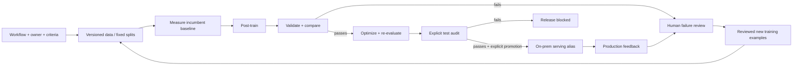

# The Sova Rig loop

**Written, not executed.** No API, worker, model import, training, benchmark,
dependency installation or test suite was launched for this change.

Rig organizes model engineering around a customer task, an owner and acceptance
criteria. It is a single-operator, single-host implementation using MLX today.

## Modules

| Concern | Module | Evidence |
|---|---|---|
| Task and acceptance | `workflows/models.py` | Immutable workflow definition |
| Cycles and releases | `workflows/service.py` | Cycle, job, events, selected report |
| Data and split protection | `data/service.py` | Dataset digest, parent, split registry |
| Offline model import | `training/imports.py` | Local copy, manifest and checksums |
| SFT | `training/service.py`, `backends/mlx.py` | Adapter, parameters and lineage |
| Baseline and quality | `evaluation/` | Per-case predictions and comparison gates |
| Performance engineering | `optimization/` | Fused/quantized model and re-evaluation |
| Serving | `serving/` | Deployment history and request traces |
| Human review | `feedback/service.py` | Approval/rejection and reviewer annotation |
| Coordination | `jobs/`, `storage/` | Local queue, SQLite and artifacts |

## 1. Define the workflow, data and baseline

Import examples through `/api/v1/datasets`, with explicit train, valid and test
splits. Workflows require all three. Acceptance prose records the business
requirement; numeric gates are what the software actually enforces.

Register a pinned, cached model, or stage a complete directory under the operator's
`RIG_MODEL_IMPORT_ROOT`. Submit `/api/v1/candidates/import-local` with
`{"name":"local-base","directory":"qwen-base"}` and poll the job for its candidate
ID. The worker copies model/tokenizer files into Rig-owned storage and records
checksums. It does not contact a model hub. Materialize symlinked cache snapshots
before importing. Imports check packaging, not model quality or load compatibility.

The baseline can be different from the trainable base: set
`pipeline.baseline_candidate_id`. Both must be supported by the configured backend.
This is a model comparison, not a benchmark of an arbitrary external production URL.

Create a workflow using [workflow.json](../examples/workflow.json), replacing its
sample IDs and agreeing thresholds with the owner. Definitions are immutable;
changing the training recipe or acceptance policy creates a new workflow definition.

## 2. One bounded improvement cycle

Submit `{}` to `/api/v1/workflows/{id}/cycles`. A cycle and queued job share an ID.
Only a separately started, execution-enabled worker runs it.

The cycle measures the incumbent, trains, validates, optionally optimizes, and
selects a candidate. Absolute gates and quality non-regression apply before
optimization. Final incumbent comparison gates apply after optimization so that
performance engineering can deliver the required speed or cost improvement.
If optimization fails, the tuned model is retained only if it meets the final gates.

Comparison settings:

- `min_score_gain: 0.02`: require two percentage points of quality gain.
- `max_latency_ratio: 0.9`: require at least 10% lower measured P95 generation latency.
- `max_estimated_cost_ratio: 0.8`: require at least 20% lower estimated generation cost.
- A null ratio disables that constraint. Zero score gain permits a tie; it is not a win.

All configured gates must pass. Missing hourly-price assumptions cannot satisfy
cost gates. Estimates cover model generation, not fully loaded business cost or
cost per accepted task. Measurements exclude loading, queueing and production
concurrency; serving traces separately retain request duration.

Read `/workflows/{id}/cycles/{cycle_id}` or the jobs endpoints for state, events,
report IDs and `next_action`. `accepted=false` is a completed experiment that missed
its gates, not a worker crash. No cycle automatically deploys a model.

One active cycle or release job is permitted per workflow. New cycles must extend
the latest cycle. Transactions enforce this, and `max_cycles` limits attempts,
including cancelled/failed jobs. There is no unlimited autonomous training loop.

## 3. Improve on new examples

The cycle's `/failures` endpoint returns validation errors. Write different examples
illustrating the failure pattern; do not move the validation questions into training.
Submit `parent_cycle_id` and `new_training_records` to start another cycle. All prior
training examples and every holdout are preserved in a new dataset version.
Each round retrains from the configured base using the accumulated data, rather than
stacking new adapters on an existing adapter.

A failed/cancelled job can be retried as a child without additions. A completed
experiment, including a gate rejection, needs new examples. Every attempt gets
fresh artifacts and a separate job.

## 4. Audit and explicitly promote

POST `/workflows/{id}/cycles/{cycle_id}/release` with `reviewer` and `note` to request
a test-split comparison of the selected candidate with a freshly measured baseline.
The workflow gates apply, and no alternate candidate is selected using test results.
One audit is permitted per cycle. Interrupted audits require operator review rather
than silent retry.

After a successful audit, POST `/cycles/{cycle_id}/promote` with
`{"release_job_id":"...","name":"support-routing"}`. The release must belong to
that exact workflow and cycle. Serve through `/v1/chat/completions` using the alias.
Re-promoting an earlier passing workflow release is explicit rollback and preserves
its provenance.

Repeated release audits on the same test set are not fresh generalization evidence.
Create new untouched release cohorts in new workflow versions when needed. Exact
split checks cannot prevent human learning from test scores or semantic leakage.
The failure-mining endpoint never serves test failures.

The low-level `/deployments` API remains a laboratory escape hatch for the single
trusted operator. It accepts passing validation reports and creates unscoped aliases.
Use workflow promotion for customer lifecycle releases. These are process controls,
not multi-role authorization or compliance enforcement.

## 5. Close the loop from production

Workflow deployments propagate workflow/cycle IDs into traces and feedback. List
feedback with `/workflows/{id}/feedback`. Content retention defaults to off. Enable
`RIG_STORE_CONTENT` under the customer's policy before collecting inputs for training.
Explicitly submitted correction text is retained even when input retention is off.

1. Submit `/feedback` with the serving request ID and a good/bad rating.
2. Submit `/feedback/{id}/review` with decision, reviewer, reason and the corrected
   target answer when approving. Approval requires retained single-turn input.
3. Start a child cycle with its parent ID and the approved `feedback_review_ids`.
4. Rig accepts only that workflow's approved reviews. Dataset checks reject duplicate
   inputs and any attempted reassignment of a held-out prompt to training.

One immutable review is recorded per feedback item; submit new feedback to supersede
it. Reviewer names are trusted-operator annotations, not authenticated identities.
The generic `/datasets/from-feedback` endpoint still supports low-level manual
imports; the workflow path uses explicit review records.

## On-prem boundary and limits

Data, model artifacts, evaluations and traces stay under `RIG_HOME`. Downloads and
execution default to off; local model import uses an operator-configured staging
root. This workflow adds no external inference provider.

On-prem does not establish an air gap. Network egress controls, TLS, encryption,
backups and retention belong to the deployment infrastructure. SDK offline flags
are not a firewall. Reference: [Hugging Face offline configuration](https://huggingface.co/docs/huggingface_hub/en/package_reference/environment_variables).

Current concrete training is **MLX LoRA SFT on Apple Silicon**. RL, DPO, NVIDIA
training, vLLM/TGI, persistent batching and distributed scheduling are not implemented.
Their adapters belong behind the existing training, optimization and inference ports;
unsupported methods must not return fabricated success. Scorers currently cover exact,
normalized-exact and numeric outputs; other acceptance rules require additional scorers.

Filesystem artifacts and database writes are not atomic together. Failed imports can
leave partial unregistered directories; rejected cycle submissions can leave an
unreferenced dataset. No deployment is changed by those failures.

## Verification

Tests were written for the closed loop, leakage protection, release identity,
comparison gates, concurrency guards, cycle limits, local imports and API authentication.
They have **not been executed**. Source-level/static checks do not establish runtime
correctness, measured model improvements or production qualification.
